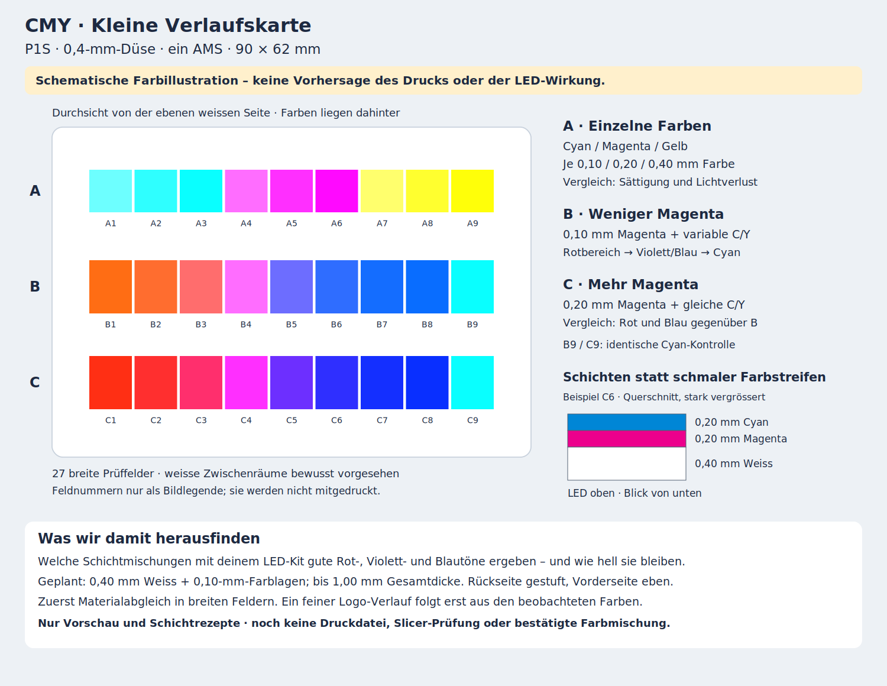

# CMY-Verlaufskarte: Vorschau für den P1S

**Nur Vorschau und konkrete Schichtrezepte. Noch keine STL-, 3MF- oder G-Code-Dateien und keine Slicer-Prüfung.** Der Benutzer möchte zunächst eine kleine Karte sehen und wissen, welche Filamente erforderlich sind.



## Filamente

Für den ersten Versuch die vier **Bambu Lab PLA Basic** aus dem **PLA CMYK Lithophane Bundle**, jeweils 1,75 mm, verwenden. Sie können auch einzeln beschafft werden. Das Set enthält hier Weiss, kein schwarzes Filament.

| Geplanter AMS-Platz | Filament | Aufgabe |
|---|---|---|
| 1 | Jade White | Weisse, durchgehende Grundfläche |
| 2 | Cyan | C-Farbschichten |
| 3 | Magenta | M-Farbschichten |
| 4 | Yellow | Y-Farbschichten |

Diese Palette ist die vom Hersteller für seine Farb-Lithophanien genannte Kombination. Das sind normale PLA-Basic-Farben; kein Leucht- oder Spezial-Transparentfilament. Vorhandenes Jade White derselben Produktlinie kann verwendet werden. Bei anderem weissem PLA würden die Ergebnisse zunächst nur für genau dieses Material gelten. Das bisherige ecoPLA Purple wird in dieser Studie nicht verwendet; Rot, Violett und Blau sollen aus Schichten der Grundfarben entstehen. Ihre genaue Wirkung ist noch nicht bekannt.

Herstellerquelle: [Bambu PLA CMYK Lithophane Bundle](https://bambulab-us.myshopify.com/products/pla-cmyk-lithophane). Die Seite nennt Cyan, Magenta, Yellow und Jade White sowie 0,4 mm als mögliche Düsengrösse. Sie nennt 0,08–0,12 mm Schichthöhen und weist auf Farbabweichungen hin. Das bestätigt keine Druckbarkeit unserer noch ungeslicten Karte. [Offizielle Bambu-Anleitung als PDF](https://store.bblcdn.com/s1/default/1d024884bbd542ef9f6795839b5285c0/Lithophane_LED_Backlight_Board_Kit.pdf). Quellen am 19. Oktober 2026 geprüft; regionale Preise und Lieferbarkeit nicht zugesichert.

## Aufbau der Karte

- **90 × 62 mm**, weisse Grundfläche 0,40 mm; die farbigen Prüffelder sind mindestens 8 mm breit.
- Erste Lage geplant 0,20 mm Weiss, danach 0,10-mm-Lagen. Drei weisse Lagen enden bei 0,20 / 0,30 / 0,40 mm.
- Auf der weissen Fläche folgen je Feld die benötigten Farbschichten in der Reihenfolge **Gelb → Magenta → Cyan**. Nicht benötigte Farben entfallen. Die Lagen liegen direkt aufeinander, ohne Luftzwischenräume oder weisse Fülllagen.
- Die weisse Bettseite ist als ebene Sichtseite vorgesehen. Das farbige Relief liegt auf der Innenseite zur LED. Gesamtdicke je Feld 0,50–1,00 mm; die weissen Zwischenräume bleiben 0,40 mm dick. Diese Versuchskarte übernimmt noch nicht die 0,60-mm-Gesamtdicke der Lampenplatte.
- Zahlen und Buchstaben sind ausschliesslich Bildlegende, keine zusätzliche Druckfarbe. Es werden weiterhin nur vier AMS-Plätze benötigt. Die Leseorientierung der späteren Druckdatei muss zur Ansicht von der weissen Unterseite passen.

Die Farben eines einzelnen Prüffelds werden **übereinander** angeordnet. Zwischen benachbarten Prüffeldern bleiben absichtlich 0,50 mm breite weisse Trennflächen. Diese Materialprobe ist noch kein durchgehender, fein aufgelöster Logo-Verlauf. Breite rechteckige Felder vermeiden zunächst die schmalen Konturfragmente der bisherigen Logo-Streifen; die vollständige Druckabdeckung ist trotzdem erst im Slicer zu prüfen.

## Was wir vergleichen

**Reihe A:** Cyan, Magenta und Gelb jeweils mit 0,10 / 0,20 / 0,40 mm Dicke. Damit beurteilen wir, wann eine Farbe zu blass oder zu dunkel wird.

**Reihe B:** 0,10 mm Magenta kombiniert zunächst mit abnehmendem Gelb, danach mit zunehmendem Cyan. So erproben wir den Bereich von warmen Farben über Magenta/Violett bis Blau.

**Reihe C:** Dieselben Cyan-/Gelbdicken, aber 0,20 mm Magenta. Das zeigt, ob mehr Magenta die gewünschten Rot-/Violett-/Blautöne verbessert oder zu viel Licht schluckt. Die letzten Felder B9 und C9 sind identische Kontrollen mit ausschliesslich 0,40 mm Cyan.

Exakte Dicken in [recipes.csv](recipes.csv); Koordinaten, AMS-Zuordnung und vollständige vertikale Schichtfolgen in [preview_checks.json](preview_checks.json). Die bevorzugten Mischungen sollen später unter demselben LED-Kit und zusätzlich unbeleuchtet beurteilt werden. Erst daraus lässt sich eine feinere Annäherung an die tatsächlichen Original-Logo-Farben ableiten. Die Original-SVGs und alle vorhandenen Lampen-/Testdateien bleiben unverändert.

## Bedeutung der Bildschirmfarben

Die Vorschau zeigt die Anordnung und das Prinzip der Farbmischung, **keine kalibrierte Vorhersage**. Zur Illustration wird jeder ideale RGB-Kanal nach `255 × exp(-0,85 × Anzahl Farblagen)` abgeschwächt: C betrifft R, M betrifft G, Y betrifft B. Der Faktor ist frei gewählt und keine Messung des Filaments. Die nominellen Herstellerfarben werden nur im Schichtdiagramm verwendet, nicht als Transmissionsmesswerte.

Streuung, Lichtverlust im weissen PLA, tatsächliche Pigmentspektren und LED-Spektrum sind nicht modelliert. Insbesondere sind keine exakten Rot-, Violett- oder Blautöne zugesichert. Die sichtbaren Stufen gehören zur Kalibrierkarte; ein glatter Verlauf wurde nicht durch Weichzeichnung vorgetäuscht.

## Prüfen und fortsetzen

Der Generator prüft die 27 Feldpositionen, ihre gegenseitige Trennung, ganzzahlige Farblagen, lückenlose vertikale Schichtfolgen, maximale Gesamtdicke und den gezielten Magenta-Unterschied zwischen B und C. Beide SVGs sind syntaktisch geprüft; die Vorschau wurde visuell kontrolliert. Diese Kontrollen sind keine Prüfung extrudierter Volumenkörper oder erzeugter Druckbahnen.

Nach Rückmeldung zur Vorschau kann daraus ein separates P1S-Druckprojekt mit 0,4-mm-Düse erstellt werden. Vor einer Druckempfehlung müssen die tatsächlichen Bahnen aller Materiallagen geprüft werden. Die bisherigen Prüfgrenzen werden nicht gelockert. Die bewusst unterschiedliche Schichtbelegung braucht eine zum Rezept passende Sollgeometrie für jede Lage; mehrere Lagen dürfen nicht zu einer scheinbaren Deckungsprüfung zusammengefasst werden.

Die Vorschau bleibt ausserhalb des bestehenden Druckpakets. Reproduktion mit den Python-Abhängigkeiten des Projekts:

```sh
python design_studies/cmy_calibration/build_preview.py
```
