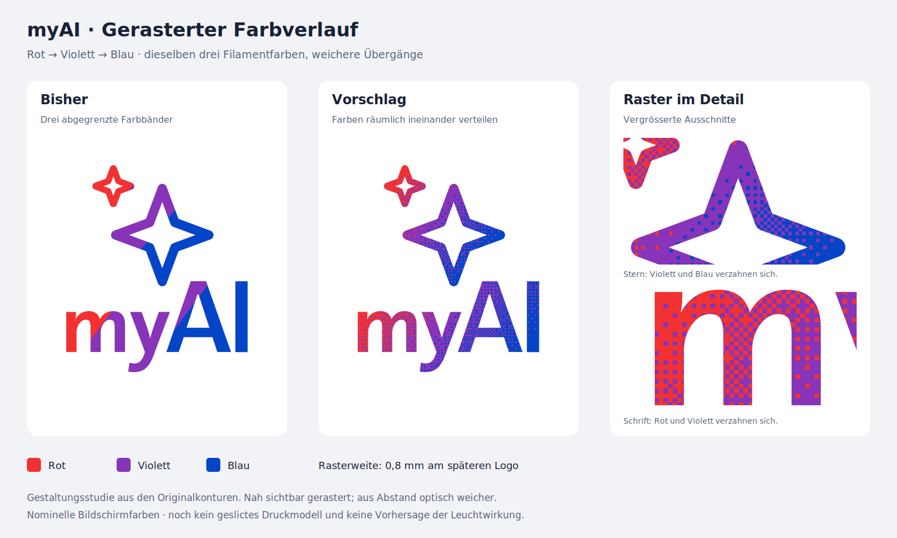

# Vorschlag: gerasterter Verlauf

Gestaltungsstudie vom 17. Oktober 2026. Der Benutzer meldet: Der AMS-Probedruck ist technisch in Ordnung, die drei harten Farbbänder gefallen ihm jedoch nicht. Gewünscht ist ein Vorschlag für einen gerasterten Verlauf.



Die Originalkonturen und die separaten Verlaufsrichtungen von Sternen und Schrift stammen aus der dunklen SVG in `assets/logos/`. Die aktuelle Palette bleibt Rot `#F23232`, Violett `#8734B8`, Blau `#0445C8`; Weiß bildet den Hintergrund. Ein geordnetes 8×8-Bayer-Raster verteilt benachbarte Farben in **0,8-mm-Zellen**. Die Farbanteile ändern sich entlang des Verlaufs stetig; jede einzelne Zelle hat genau eine Filamentfarbe. Die Übergänge liegen bei den normierten Verlaufspositionen 0,00 (Rot), 0,36 (Violett) und 0,80 (Blau). Diese Farbverteilung ist eine neue gestalterische Annäherung, keine exakte Wiedergabe aller Original-Farbstopps.

Der Vorschlag zeigt eine optische Mischung durch benachbarte Flächen. Aus der Nähe bleibt die Körnung sichtbar. Er enthält weder zusätzliche Filamentfarben noch einen tatsächlich kontinuierlich gemischten Farbton.

**Historische Gestaltungsstudie:** Die Bilder hier sind SVG-/PNG-Vorschläge. Inzwischen steht eine [geslicte Rasterprobe in Originalgröße](../../docs/RASTERPROBE.md) mit 0,2 mm Farbe + 0,4 mm Weiß bereit; sie bereinigt winzige Randinseln und prüft den Erhalt der vollständigen Rasterzellen in den Druckbahnen. Die reale Wirkung ist noch offen. An den Logokonturen entstehen angeschnittene Zellen, die deutlich schmaler als 0,8 mm sein können. Die Druckprobe übernimmt deshalb nicht jede angeschnittene Farbinsel unverändert. Die Bildschirmansicht sagt weder die echten Filamentfarben noch die beleuchtete Wirkung voraus. Die reguläre v4.2 wird weiterhin aus `cad/build_multicolor.py` erzeugt; diese Studie ist separat und gehört nicht zum Druckpaket.

Reproduzieren, vom Repository-Stamm:

```sh
.venv/bin/python design_studies/dither/build_preview.py
```

`logo_dither.svg` besitzt eine 116 × 116 mm große Zeichenfläche entsprechend der Skalierung im CAD. Für eine spätere Integration ist weiterhin die tatsächliche Logokontur auf der Seitenplatte zu zentrieren.
