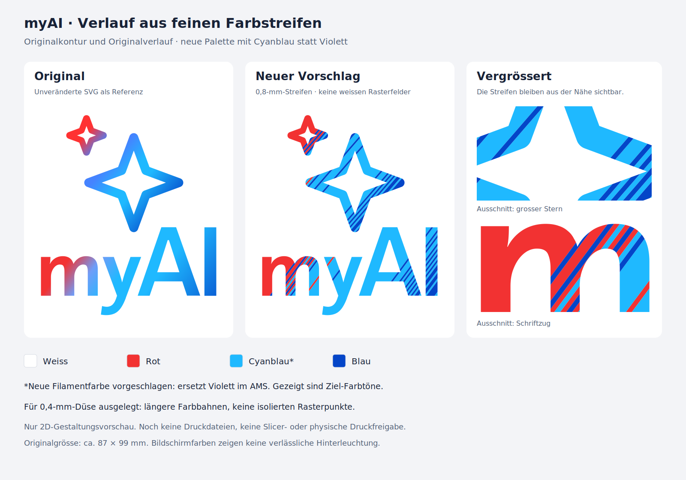

# Vorschau: Verlauf aus Farbstreifen

**Nur Gestaltungsvorschlag, 18. Oktober 2026.** Der Benutzer möchte zuerst die Vorschau beurteilen. Es wurden keine STL-, 3MF- oder G-Code-Dateien erzeugt und keine Produktionsprofile geändert.

Der Vorschlag übernimmt die Konturen und die beiden tatsächlichen Farbverläufe der unveränderten dunklen Original-SVG. Im Original dominieren neben Rot helle Blau- und Cyanbereiche. Die hier vorgeschlagene Palette ersetzt daher **Violett durch Cyanblau**: Weiss, Rot, Cyanblau und Blau passen weiterhin in das vorhandene Vierfarben-AMS. Das ist eine vorgeschlagene Materialänderung, keine bereits getroffene Kaufentscheidung. Die gezeigten Hexfarben sind Zielwerte, keine Messungen an Filament oder hinterleuchtetem PLA.

Statt weisser Rasterfelder und kleiner Farbquadrate verwendet der Entwurf **0,8 mm breite diagonale Streifen**, jeweils quer zur ursprünglichen Verlaufsrichtung. Benachbarte Streifen gleicher Farbe verschmelzen zu breiteren Flächen. Die Farbanteile werden aus den Original-Farbstopps mit einer Annäherung in linearem RGB berechnet; es gibt keine neuen künstlichen Verlaufsstopps und kein Weiss innerhalb der Farbflächen. Der Übergang bleibt aus der Nähe gestreift; die Vorschau zeigt ihn ungefiltert, auch vergrössert.

## Bezug zur 0,4-mm-Düse

Die reguläre Streifenbreite entspricht zwei nominellen 0,4-mm-Bahnen. Längere Farbbereiche vermeiden die vielen winzigen Start-/Stop-Inseln des bisherigen Punktrasters. Kleine, angeschnittene Farbinseln ohne Platz für einen Kreis mit 0,5 mm Durchmesser werden einer angrenzenden Farbe zugeordnet. Die gesamte Logokontur bleibt dabei erhalten. Ein winziger, isolierter Bestandteil der Originalkontur am A (rund 0,0005 mm²) bleibt in dieser reinen Vorschau dokumentiert; bei einer späteren Druckableitung ist er ausdrücklich zu behandeln.

**Das ist noch kein Nachweis eines lückenlosen Drucks.** 0,8 mm ist die reguläre Streifenbreite, keine Mindestbreite an jeder gekrümmten Kante. Spitze Übergänge, Bahnenden, tatsächliche Linienbreiten und Farbhaftung müssen nach positiver optischer Rückmeldung im Slicer und später am Probedruck geprüft werden. Der vorgesehene Aufbau bleibt 0,2 mm Farbe über 0,4 mm Weiss. Die Vorschau bestätigt weder die reale Leuchtwirkung noch die Druckbarkeit aller Randdetails.

Der [2D-Prüfbericht](preview_checks.json) bestätigt die lückenlose Aufteilung der abgetasteten Originalkontur ohne Farbüberlappungen. Diese reine Flächenaufteilung ist ausdrücklich **keine Druckbahnprüfung**. Die regulären v4.2-Druckdateien und die verworfenen Rasterstudien bleiben unverändert.

## Dateien

- [Vergleich als PNG](comparison.png), [Vergleich als SVG](comparison.svg)
- [Logo allein als SVG](proposal.svg), in der vorgesehenen Originalgrösse
- Reproduzierbarer Generator: `build_preview.py`; benötigt NumPy, Shapely, svgpathtools und CairoSVG. Vom Repository-Stamm mit einem passenden Python ausführen: `python design_studies/line_gradient/build_preview.py`.

Die ursprüngliche 0,8-mm-Studie bleibt eine Vorschau. Ihre Quellen sind inzwischen zur Reproduktion der Vergleichsansicht im Druckpaket enthalten. Die später vom Benutzer zum Test freigegebene 0,48-mm-Variante wurde als [Testkarte 11](../../docs/FARBBAHNEN_TEST.md) geslict; sie besteht die Flächenprüfung noch nicht.
