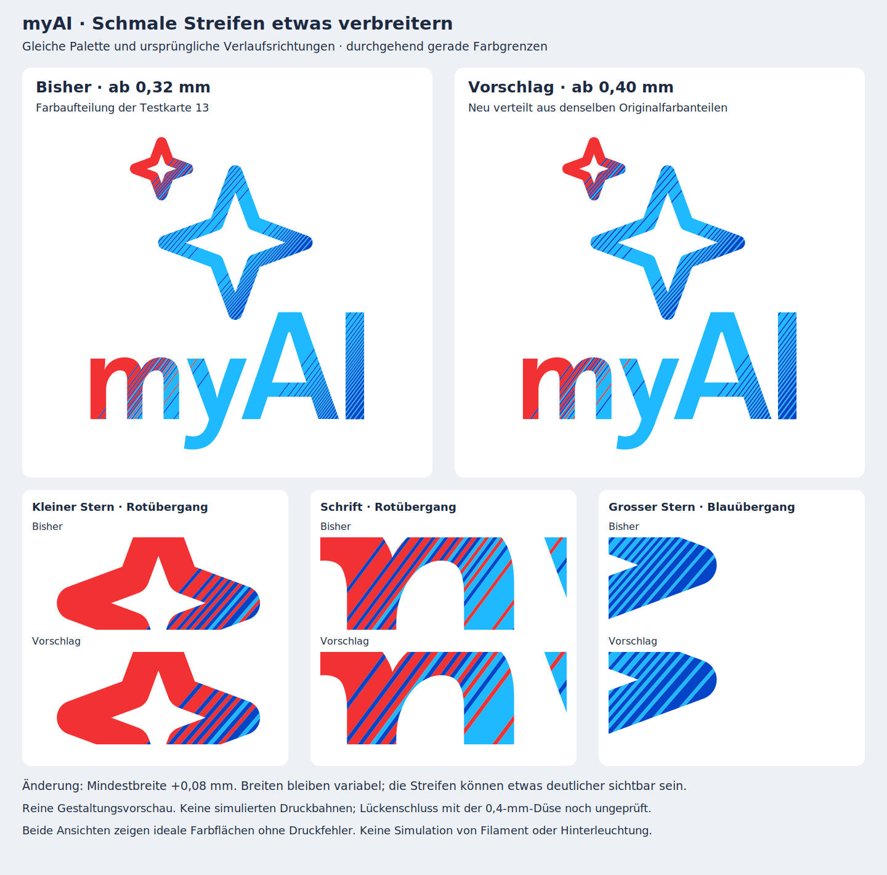

# Vorschlag: Mindestbreite 0,40 mm für gerade Farbstreifen

**Nur Gestaltungsvorschau, noch keine Druckfreigabe.** Der Benutzer verlangt zunächst eine Vorschau einer möglichst kleinen Designänderung gegen die weissen Lücken bei weiterhin geraden Streifen und einer 0,4-mm-Düse.



## Was sich ändert

Ein einzelner Gestaltungsparameter wird geändert: **Mindestbreite 0,32 → 0,40 mm** vor dem Konturbeschnitt, also +0,08 mm beziehungsweise +25 %. Die Farbverteilung wird mit demselben Algorithmus aus den Originalfarbanteilen neu berechnet. Dies ist ein vorsichtiger Entwurf für breitere schmale Bahnen, keine ermittelte Mindestbreite für garantiert lückenfreien Druck. Die bisherige Prüfung auch breiterer, anders verteilter Streifen zeigt, dass allein die Bandbreite keinen Lückenschluss beweist.

Die Grenzen bleiben durchgehend gerade und parallel. Konturen, Verlaufsrichtungen, Palette und Umschaltschwelle sind unverändert. Es entstehen keine Knicke, Rundungen oder Randzonen. Geplant bleiben 0,2 mm Farbe und 0,4 mm weisse Rückschicht; diese Vorschau enthält keine Volumenkörper und ändert keine Druckdateien.

Variable Breiten bleiben erhalten, statt die Streifen auf feste Vielfache einer Rasterbreite zu runden. Die breiteren schmalen Bahnen erfordern jedoch eine neue Verteilung. Dadurch entstehen **141 statt 175 Intervalle** über beide Verlaufsachsen. Diese Zahlen zählen auch Intervalle vor dem Konturbeschnitt, nicht einzelne Druckbahnen. Aus der Nähe kann der Verlauf gröber wirken. Die Detailansichten zeigen diesen Kompromiss ohne Weichzeichnung.

## Wie ähnlich bleibt die Farbverteilung?

Über die gesamte Logo-Farbfläche ändern sich die Flächenanteile gegenüber Testkarte 13 wie folgt:

| Farbe | Änderung in Prozentpunkten |
|---|---:|
| Rot | +0,035 |
| Cyanblau | +0,187 |
| Blau | −0,222 |

Das sind ähnliche **Gesamtanteile**, kein Beleg identischer lokaler Farben oder Leuchtwirkung. Durch die neue Position und Breite der Streifen wechselt auf **23,81 % der Logo-Fläche** die zugewiesene Farbe. Es wäre daher falsch, von nur 0,22 % geänderter Gestaltung zu sprechen. Die grösste kumulierte Abweichung vom Ziel-Farbanteil entlang der Verlaufsachse beträgt 0,378 mm für die Schrift beziehungsweise 0,400 mm für die Sterne. Die bisherige 0,32-mm-Variante erreichte 0,273 beziehungsweise 0,262 mm.

## Prüfstand und nächster Schritt

Der Generator kontrolliert die Mindestbreiten vor dem Beschnitt, lückenlos anschliessende Intervalle, gültige Farbflächen sowie vollständige 2D-Abdeckung ohne Überlappungen. Beide Gruppen stammen aus der unveränderten Original-SVG. Der Bericht speichert die Original- und Vergleichsdatei-Hashes sowie sämtliche Intervalle.

**Diese Vorschau beweist nicht, dass die weissen Drucklücken verschwinden.** An der unveränderten Kontur bleiben spitz zulaufende Reststücke möglich. Auch zwischen benachbarten gedruckten Farben können weiterhin Lücken entstehen. Beide Vergleichsbilder zeigen ideale Designflächen; die fehlenden Druckbahnen des bisherigen Entwurfs sind nicht im linken Bild simuliert. Die nominellen Bildschirmfarben sagen nichts über reales Filament oder Hinterleuchtung aus.

Nach Rückmeldung zur Vorschau wäre diese Farbaufteilung als eigene Testkarte zu slicen und gegen die vollständigen Flächen jeder Farbschicht zu prüfen. Die bisherigen Grenzwerte bleiben bestehen. Keine erneute Druckempfehlung ohne bestandene Prüfung; neue Druckdateien werden erst nach der Vorschau-Rückmeldung erzeugt.

Die Studie bleibt ausserhalb des bestehenden Druckpakets. Archivierte Vorschauen und Testkarte 13 bleiben unverändert.

[Vorschlag als SVG](proposal.svg) · [Vergleich als SVG](comparison.svg) · [2D-Prüfbericht](preview_checks.json) · [Vorherige erfolglose Slicer-Prüfung](../../docs/LUECKENSCHLUSS_PRUEFUNG.md)

Reproduktion vom Repository-Stamm mit Python und den Abhängigkeiten aus `cad/requirements.txt`:

```sh
python design_studies/line_gradient_040/build_preview.py
```
