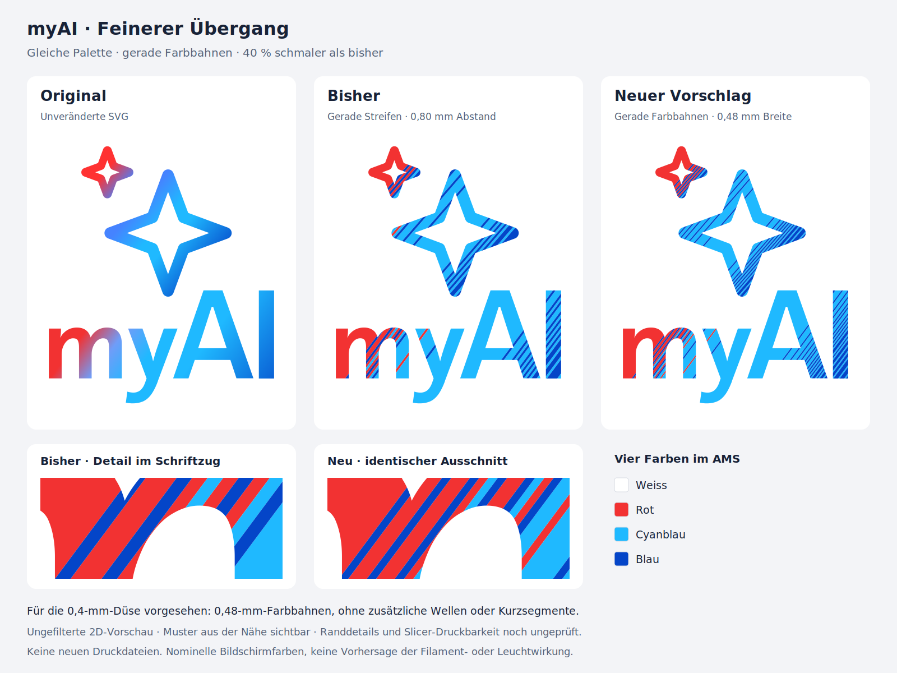

# Vorschau: feinere gerade Farbbahnen

**Reine 2D-Gestaltungsstudie. Keine neuen Druckdateien.** Der Benutzer beurteilt die neue Rot/Cyanblau/Blau-Palette als näher am Original, findet die bisherigen 0,8-mm-Streifen aber zu auffällig. Der neue Vorschlag reduziert ihre reguläre Breite auf **0,48 mm**, also um 40 Prozent. Kontur, Original-Farbstopps, Logogrösse und Palette bleiben gleich.

Die Bahnen verlaufen weiterhin gerade quer zur jeweiligen Original-Verlaufsrichtung. Gleiche benachbarte Farben können grössere zusammenhängende Flächen bilden. Aus der Nähe bleibt das Muster sichtbar; die Vorschau wird nicht weichgezeichnet. Die unteren Ausschnitte zeigen denselben Bereich in derselben Vergrösserung.

## Warum keine Wellen?

Ein zwischenzeitlich betrachteter Wellenverlauf sollte lange diagonale Linien optisch aufbrechen. Der Benutzer wies auf die zusätzliche Druckkomplexität hin. Der sichtbare Gewinn rechtfertigt die zusätzlichen Richtungswechsel nicht; dieser Ansatz ist verworfen. Auch ein untersuchtes Kurzlinienraster erzeugt zusätzliche Ansetzpunkte. Die vorliegende Vorschau verwendet deshalb ausschliesslich gerade Bahnen.

## Bezug zur 0,4-mm-Düse

0,48 mm ist als Breite einer einzelnen Extrusionsbahn mit der vorhandenen 0,4-mm-Düse vorgesehen. **Das ist eine Konstruktionsabsicht, noch kein Nachweis im Slicer.** Gegenüber 0,8 mm bleibt weniger geometrische Reserve. Angeschnittene Konturen, Farbgrenzen, Bahnenden und Lückenschluss müssen nach Beurteilung der Vorschau mit den tatsächlichen Druckbahnen geprüft werden. Kürzere Streifen an den Logo-Rändern lassen sich nicht vollständig vermeiden.

Die 2D-Prüfung bestätigt eine lückenlose Aufteilung der abgetasteten Originalkontur ohne überlappende Farben. Kleine angeschnittene Inseln ohne Platz für einen Kreis mit 0,4 mm Durchmesser werden angrenzenden Farben zugeordnet. Ausgenommen bleibt der bereits dokumentierte winzige, isolierte Originalbestandteil am A (rund 0,0005 mm²); er ist bei einer späteren Druckableitung ausdrücklich zu behandeln. Weder diese Inselprüfung noch die Flächenaufteilung beweist, dass jeder Rand mit realen Druckbahnen abgedeckt wird.

Vorgesehen bleiben 0,2 mm Farbe und 0,4 mm weisse Rückschicht. Die nominellen Bildschirmfarben sind keine Vorhersage der realen Filament- oder Leuchtwirkung. Es gibt keine physische Bestätigung dieser Variante.

## Dateien und Reproduktion

- [Vergleich als PNG](comparison.png) und [als SVG](comparison.svg)
- [Logo allein als SVG](proposal.svg), [2D-Prüfbericht](preview_checks.json)
- [Vorheriger Vorschlag mit 0,8 mm](../line_gradient/README.md)

Vom Repository-Stamm mit Python, NumPy, Shapely, svgpathtools und CairoSVG ausführen: `python design_studies/line_gradient_fine/build_preview.py`. Die Vergleichsansicht liest zusätzlich die vorherige Vorschau aus `design_studies/line_gradient/proposal.svg`.

Die Studie liegt ausserhalb des Druckpakets. Produktionsprofile, CAD und vorhandene Druckdateien bleiben unverändert. Eine Druckprobe folgt erst nach der optischen Beurteilung.
