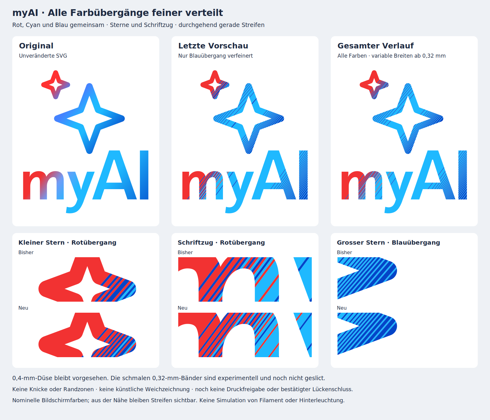

# Gesamtvorschau: feinere gerade Farbstreifen in allen Übergängen

**Beide Originalverläufe sind jetzt vollständig überarbeitet: Sterne und Schriftzug, einschliesslich Rot → Blau/Cyan und Hellblau → Dunkelblau.** Die letzte Vorschau hatte nur den Blauübergang verändert. Diese neue Studie verteilt alle drei Logofarben gemeinsam über variable, durchgehend gerade Streifen.



Der P1S mit **0,4-mm-Düse** bleibt vorgesehen. **Nur eine 2D-Vorschau, noch nicht geslict und keine Druckfreigabe.** Die nominell mindestens 0,32 mm breiten Bänder sind experimentell. Es wurden keine neuen STL-, 3MF- oder G-Code-Dateien erzeugt.

## Durchgängige Änderung

Die Farbanteile kommen weiterhin aus den unveränderten Originalverläufen, angenähert mit Rot `#F23232`, Cyanblau `#1FB9FF` und Blau `#0445C8`. Weiss bleibt der Hintergrund. Die beiden unterschiedlichen Verlaufsrichtungen für Sterne und Schrift bleiben erhalten.

Anstelle fester 0,44-mm-Schritte wird laufend berechnet, welche Farbe gegenüber ihrem gewünschten Anteil fehlt. Ein Wechsel erfolgt an dieser berechneten Position, sobald die Mindestbreite erreicht ist. So können die Breiten zwischen den früheren 0,44-/0,88-/1,32-mm-Stufen liegen. Ein seltener dritter Farbanteil erhält einzelne schmale Bahnen; er legt keinen langen Wiederholungsabstand für alle Farben fest. Kein Farbanteil wird durch eine 2-%-Schwelle ausgefiltert. Auch die roten und fast einfarbigen Abschnitte werden durch denselben Algorithmus behandelt.

- Durchgehend gerade, parallele Farbgrenzen bis zur ursprünglichen Logokontur.
- Keine Knicke, zurückgesetzten Enden, Rundungen oder umlaufenden Randzonen.
- Nominell mindestens **0,32 mm vor dem Konturbeschnitt**, rund 27 % schmaler als die bisherige Grundbreite von 0,44 mm. Nicht jede Bahn ist gleich breit.
- Keine künstliche Aufhellung, Beleuchtung oder Weichzeichnung in der Vorschau.

Zum jeweiligen Farbende hin dürfen überwiegende Farbanteile breiter werden. Ein unsichtbarer, kontinuierlicher Verlauf lässt sich mit der kontrastreichen diskreten Palette nicht zusichern. Bildschirmfarben sind keine Messung von Filamenten oder Hinterleuchtung.

## Gesamthaft geprüft

Der Vergleich zeigt das komplette Logo sowie identische Vorher-/Nachher-Ausschnitte für den **kleinen Stern**, den **Rotübergang im Schriftzug** und den **Blauübergang im grossen Stern**. Die linke Gesamtansicht ist die Original-SVG, die mittlere die tatsächlich gespeicherte letzte Blau-only-Vorschau und die rechte der neue Gesamtentwurf.

Die numerische Kontrolle umfasst beide Verlaufsgruppen und sämtliche Farben. Alle 175 erzeugten Intervalle entlang der beiden Verlaufsachsen sind vor dem Konturbeschnitt mindestens 0,32 mm breit. Die Farbflächen sind gültige Polygone; ihre Vereinigung deckt die beabsichtigte Kontur ohne 2D-Lücken und ohne Überlappung ab. Das bekannte isolierte Originalfragment unter 0,001 mm² wird wie in den vorherigen Ableitungen ausgelassen.

Die grösste kumulierte Abweichung zwischen gewünschtem und zugewiesenem Farbanteil entlang der Verlaufsachse beträgt **0,2732 mm für die Schrift** beziehungsweise **0,2618 mm für die Sterne**. Das ist ein Mass für die Verteilung der Bandbreiten, keine Messung der Farbe, der nach Konturbeschnitt gewichteten Farbfläche oder der wahrgenommenen Glätte. Der [Prüfbericht](preview_checks.json) enthält alle Intervalle, Original-/Vergleichsdatei-Hashes und tatsächlichen Farbflächen.

Zusätzlich geprüft: reine Farbe, zwei gleich häufige Farben, eine seltene dritte Farbe und eine ungleiche Dreifarbenmischung. Die Prüfungen kontrollieren Mindestbreiten, vollständige Teilnahme der geforderten Farben, lückenlos anschliessende Intervalle und begrenzte Abweichung der integrierten Farbanteile.

**Offen bleibt die Druckprüfung:** An schrägen oder gekrümmten Logokonturen können trotz nomineller Mindestbreite kleinere Reststücke entstehen. Weder vollständige Extrusionsbahnen noch geschlossene gedruckte Farbflächen sind bestätigt. Auch die zuvor beobachteten weissen Druckstellen sind durch diese Vorschau nicht nachweislich behoben. Keine Druckdateien vor Beurteilung der Gestaltung; danach sind CAD, Slicer und die unveränderte vollständige Flächenprüfung erforderlich.

## Dateien und Reproduktion

[Vorschlag als SVG](proposal.svg) · [Vergleich als SVG](comparison.svg) · [2D-Prüfbericht](preview_checks.json)

```sh
python design_studies/line_gradient_full/build_preview.py
python design_studies/line_gradient_full/validate_preview.py
```

Python-Abhängigkeiten gemäss `cad/requirements.txt`. Die Original-Farbanteile werden entlang der Verlaufsachse mit höchstens 0,01 mm Schrittweite integriert; Umschaltpositionen werden zwischen den Abtastpunkten bestimmt. Mindestbreite und Umschaltschwelle stehen im Generator. Die Studie liegt ausserhalb des Druckpakets. Frühere Vorschauen, reguläre Seitenplatten, Druckdateien und ZIP-Pakete bleiben erhalten.
