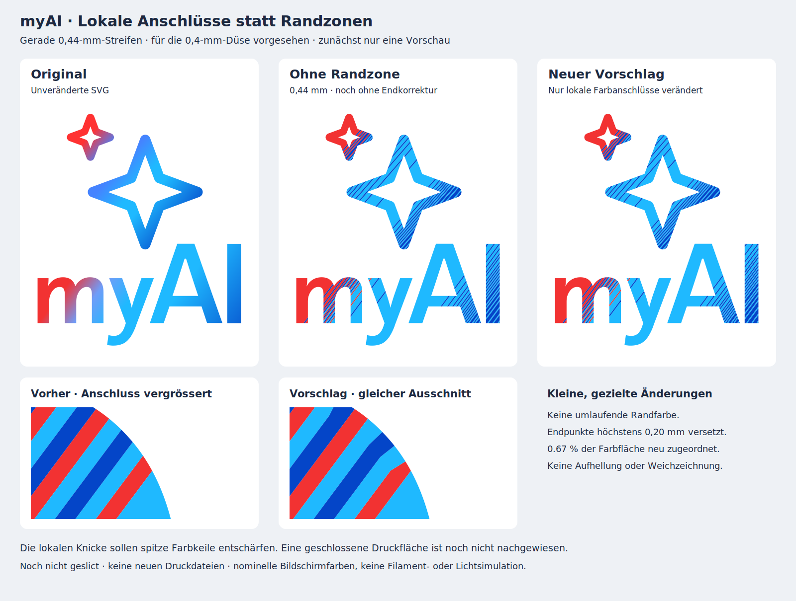

# Vorschau: lokale Streifenanschlüsse ohne Randzonen

**Nur eine Gestaltungsvorschau für den P1S mit 0,4-mm-Düse. Noch nicht geslict, keine Druckfreigabe und keine neuen STL-, 3MF- oder G-Code-Dateien.** Der Benutzer hat die sichtbaren Randzonen der Testkarte 12 verworfen und ausdrücklich zuerst eine Vorschau der Alternative angefordert.



Die geraden **0,44-mm-Bänder** und ihre Farben bleiben bis zur Logokontur erhalten. An schrägen Anschlüssen wird nur die gemeinsame Grenze zwischen zwei Farben lokal versetzt: höchstens **0,20 mm am Konturpunkt**, über höchstens **0,50 mm Länge** innerhalb des Logos. Daraus entstehen kleine lokale Knicke statt umlaufender Farbränder oder gerundeter, zurückgesetzter Streifen. Der Ansatz soll sehr spitze Farbkeile entschärfen, die der Slicer bisher nicht vollständig gefüllt hat. Die Auswahl der Stellen erfolgt hier geometrisch anhand der Anschlussrichtung, nicht anhand eines neuen Slicer-Laufs. Es können weiterhin zu schmale Spitzen entstehen oder verbleiben.

**384 lokale Anpassungen verteilen insgesamt 0,669 % der Logofläche um.** Vergleichsbasis sind dieselben unkorrigierten 0,44-mm-Bänder; bei Testkarte 12 waren es 5,46 %. Das ist keine Messung der wahrgenommenen Farbänderung. Die Vorschau zeigt deshalb zusätzlich identisch vergrösserte Ausschnitte. Eine unsichtbare Änderung wird nicht zugesichert.

Die vollständigen Konturen und die getrennten Verlaufsrichtungen für Sterne und Schrift stammen aus der unveränderten dunklen Original-SVG. Die Farbmischung wird wie in den bisherigen Streifenstudien in linearem RGB angenähert und über aufeinanderfolgende Bänder verteilt. Das bereits dokumentierte Originalfragment unter 0,001 mm² wird ausgelassen. Keine gezielte Aufhellung, keine Beleuchtung und keine Weichzeichnung zur Kaschierung der Streifen.

Palette dieser Studie: **Weiss, Rot `#F23232`, Cyanblau `#1FB9FF`, Blau `#0445C8`**. Cyan ersetzt in den Streifenstudien Violett. Nominale Bildschirmfarben sind keine Vorhersage von Filament oder Hinterleuchtung. Die regulären Lampenseiten und ihre Produktionspalette werden nicht verändert.

## Geprüft und offen

Der [2D-Bericht](preview_checks.json) dokumentiert Originaldatei-Hash, Flächenumverteilung, lokale Verschiebungen und Farbflächen vor/nach der Änderung. Die berechneten Polygone sind gültig; sie decken die vorgesehene Kontur ohne gewollte weisse Lücken ab und überlappen sich nur im numerischen Rundungsbereich. Diese Flächendeckung ist **kein Nachweis gedruckter Abdeckung**. Die 0,44-mm-Bandbreite garantiert insbesondere nicht, dass an jeder Kontur eine ausreichend breite Druckbahn entsteht.

Nach Beurteilung dieser Vorschau wären ein eigener CAD-Entwurf, Slicing und die unveränderte vollständige Druckbahnprüfung erforderlich. Erst deren Ergebnis kann zeigen, ob dieser Ansatz die Lücken tatsächlich schliesst. Keine Übertragung auf die vier Seitenplatten und kein physischer Test.

## Dateien

- [Vorschlag als SVG](proposal.svg)
- [Unkorrigierte 0,44-mm-Aufteilung zum Vergleich](uncorrected.svg)
- [Vergleich als SVG](comparison.svg)
- [Messwerte und lokale Änderungen](preview_checks.json)

Erneut erzeugen mit einer Python-Umgebung gemäss `cad/requirements.txt`:

```sh
python design_studies/line_gradient_local/build_preview.py
```

Die Studie liegt separat ausserhalb des Druckpakets. Bestehende Druckdateien und Pakete bleiben in diesem Vorschau-Schritt unverändert.
