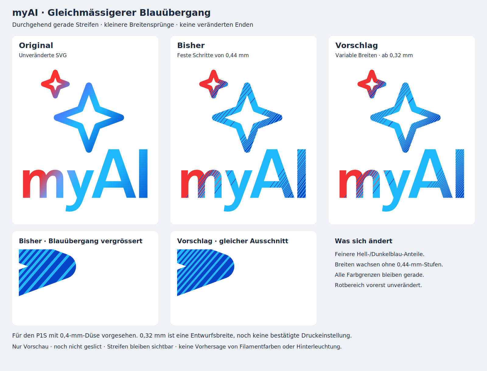

# Vorschau: gleichmässigerer Blauübergang mit geraden Streifen

**Gestaltungsstudie, noch nicht geslict.** Zielgerät bleibt der P1S mit **0,4-mm-Düse**. Es wurden keine neuen Druckdateien erzeugt. Die nominell mindestens **0,32 mm** breiten neuen Farbbänder sind ein experimenteller Entwurf und noch keine bestätigte Druckeinstellung.



## Das eigentliche Problem

Die bisherige Farbverteilung verwendet feste 0,44-mm-Schritte. Benachbarte Zellen derselben Farbe verschmelzen dabei zu 0,88, 1,32 oder 1,76 mm breiten Bändern. Diese ganzen Rasterstufen machen den Übergang stellenweise grob, obwohl die Grundstreifen schmal aussehen. Mit zunehmendem Dunkelblau-Anteil müssen die dunklen Flächen mehr Platz einnehmen; die Verbreiterung muss aber nicht in festen 0,44-mm-Sprüngen erfolgen.

Die neue Variante verwendet im **Hellblau-/Dunkelblau-Übergang variable Breiten und Abstände**. Die seltener vorkommende Farbe bekommt eine feinere Bahn; die andere Farbe nimmt den verbleibenden Anteil ein. Beide Farbgrenzen bleiben vollständig gerade und parallel, bis sie die ursprüngliche Logokontur schneiden. Keine lokalen Knicke, keine gerundeten Enden, keine Randzonen.

Die angestrebten Farbanteile kommen weiterhin aus dem Originalverlauf. Für jeden Abschnitt wird der jeweils kleinere Blauanteil integriert und in vollständige Wiederholungen mit mindestens 0,32 mm pro Farbe aufgeteilt. Die tatsächlich erzeugte kleinste Bandbreite beträgt rund **0,3204 mm**. Es entstehen 57 Blau-/Cyan-Paare über die beiden Verlaufsrichtungen. Die resultierenden Breiten werden direkt aus den integrierten Anteilen berechnet und nicht auf ein 0,44-mm-Raster gerundet.

**Der Rotbereich bleibt in dieser Vorschau unverändert.** Angepasst werden nur Bereiche mit ausschliesslich Blau/Cyan in der Palettenannäherung und einem Blauanteil zwischen 2 und 98 %. Die fast einfarbigen Bereiche behalten das bisherige Muster. Dadurch bleibt insbesondere die kleine rote Sternform erhalten; die gesamte Illustration zeigt beide Zustände zur Kontrolle. Ein Vergleichsbild verwendet identische, ungefilterte Ausschnitte aus dem grossen Stern.

## Grenzen der Vorschau

Der Entwurf soll feinere Abstufungen zeigen, keinen unsichtbaren Verlauf versprechen. Der starke Kontrast zwischen den beiden vorhandenen Blautönen bleibt sichtbar. Zum dunklen Ende hin werden dunkle Bänder weiterhin breiter; der Unterschied liegt in der feineren, variablen Aufteilung.

Die Original-SVG, ihre Konturen und getrennten Verlaufsrichtungen für Sterne und Schrift bleiben die Quelle. Das bekannte Originalfragment unter 0,001 mm² ist wie in den anderen Druckableitungen ausgelassen. Palette: Weiss, Rot `#F23232`, Cyanblau `#1FB9FF`, Blau `#0445C8`; Cyan ersetzt in diesen Studien Violett. Die Bildschirmfarben sind keine Messung der Filamente oder Hinterleuchtung. Keine Beleuchtung oder Weichzeichnung zur optischen Glättung.

Die mathematische Aufteilung deckt die Kontur vollständig und ohne Farbüberlappungen ab. Das beweist **keine vollständige Druckbahnabdeckung**. Besonders an schrägen Konturen entstehen weiterhin schmalere Reststücke. Es wurde weder der Slicer geprüft noch ein physischer Test durchgeführt; die Lückenfrage bleibt offen. Eine 0,4-mm-Düse, die entworfene Bandbreite und die tatsächlich geslicte Extrusionsbreite sind unterschiedliche Grössen.

Die integrierten Farbanteile beziehen sich auf die Verlaufsachse. Nach Beschnitt mit der Logokontur steigt die gesamte blaue Fläche gegenüber der bisherigen 0,44-mm-Aufteilung um rund 2,82 mm², Cyan nimmt entsprechend ab; Rot bleibt geometrisch unverändert. Das ist kein Nachweis einer exakten optischen Übereinstimmung mit dem Original.

## Dateien und Prüfung

- [Vorschlag als SVG](proposal.svg)
- [Bisherige gerade 0,44-mm-Bänder als SVG](previous.svg)
- [Vergleich als SVG](comparison.svg)
- [2D-Prüfbericht und sämtliche Bandbreiten](preview_checks.json)

Der Bericht enthält Originaldatei-Hash, alte zusammenhängende Farbläufe, neue Farbpaare, Flächen und Prüfgrenzen. Der Generator prüft gültige Polygone, lückenlose 2D-Abdeckung, fehlende Überlappung, unveränderte rote Geometrie und die nominelle Mindestbreite vor Konturbeschnitt. Die Originalfarbanteile werden mit höchstens 0,02 mm Schrittweite abgetastet und trapezförmig integriert.

```sh
python design_studies/line_gradient_smooth/build_preview.py
```

Benötigt die Python-Abhängigkeiten aus `cad/requirements.txt`. Diese frühere Teilvorschau wird inzwischen zur Reproduktion der [Gesamtvariante und Testkarte 13](../../docs/FARBBAHNEN_GESAMT_TEST.md) im aktuellen Druckpaket mitgeführt. Sie ist selbst keine Druckdatei; ihr Vorschau-Prüfstand bleibt erhalten.
