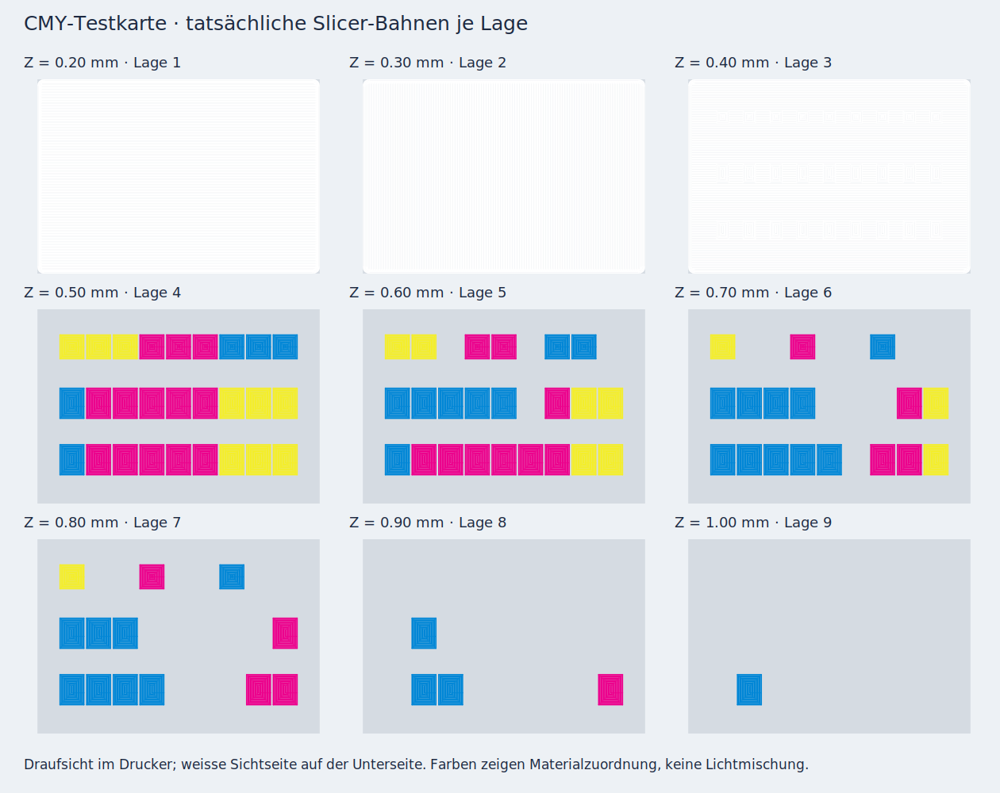

# CMY-Testkarte 14 für den P1S

**Für einen physischen Farbtest vorbereitet: im Slicer geprüft, noch nicht physisch bestätigt.** Die Karte setzt die freigegebene Vorschau und deren Schichtrezepte unverändert um. Sie dient zum Abstimmen der CMY-Schichtmischung unter dem vorhandenen LED Lamp Kit, noch nicht als fertiges Lampenlogo.

## Datei öffnen und drucken

[**Vorbereitetes P1S-Projekt öffnen: 14_cmy_calibration_P1S.3mf**](../output/cmy_calibration/print/14_cmy_calibration_P1S.3mf)

In Bambu Studio **als Projekt** öffnen, damit Materialzuordnung, Schichtdicken, Druckorientierung und die Einstellungen der einzelnen Teile erhalten bleiben. Die enthaltene Geometrie-3MF und die Einzel-STLs sind nur zur Bearbeitung gedacht. Die Bauteile gehören als vier Materialteile zu einem Objekt; nicht einzeln anordnen oder auf das Bett absenken.

| Einstellung | Vorbereitet |
|---|---|
| Drucker / Düse | Bambu Lab P1S / 0,4 mm |
| Druckplatte | Strukturierte PEI-Platte |
| Filament | Bambu Lab PLA Basic, 1,75 mm |
| AMS 1 | **Jade White** |
| AMS 2 | **Cyan** |
| AMS 3 | **Magenta** |
| AMS 4 | **Yellow** |
| Temperatur | 220 °C Düse / 55 °C Bett |
| Erste Schicht / danach | 0,20 mm / 0,10 mm |
| Abmessungen | 90 × 62 mm, maximal 1,00 mm dick |
| Stützen | Keine |
| Slicer-Schätzung | **1 h 23 min**, **10,89 g** inklusive Reinigung und Turm |
| Farbwechsel | 10 |

Vor dem Senden die vier Projektfarben den tatsächlich geladenen AMS-Fächern zuordnen. Die Profile enthalten die offiziellen Bambu-PLA-Basic-Werte für das Standard-Hotend des P1S. Bauteillüfter nach zwei Lagen auf 50 %, Zusatzlüfter aus. Hersteller-Start-/End-G-Code unverändert übernommen. Farbwechsel reinigen in den vorgesehenen Bereichen und Turm; nicht in die Karte spülen.

Die geprüfte Datei stammt aus **Bambu Studio 02.08.02.61**. Eigenes Neuslicen oder Änderungen an Filament, Platte oder Profil können andere Bahnen ergeben; der gespeicherte Prüfbericht gilt für die ausgelieferte Datei und ihren Hash.

## Orientierung und Beurteilung

Die **weisse, ebene Seite liegt beim Drucken auf dem Bett**. Die farbigen, gestuften Schichten liegen oben und zeigen später zur LED. Für den Farbtest durch die weisse Seite schauen. Die Karte ist entsprechend gespiegelt: Von der weissen Seite aus liegt die Referenzreihe A oben, Cyan links und Gelb rechts, wie in der folgenden Feldlegende.


Die Bezeichnungen A1–C9 stehen nur in der Legende, nicht auf dem gedruckten Teil. Die weissen Trennflächen zwischen den Feldern sind beabsichtigt. Die Karte zuerst auf Raumtemperatur abkühlen lassen und dann vorsichtig von der Platte lösen.

Vergleiche unter möglichst gleichmässiger Beleuchtung durch dein LED-Kit:

1. **Reihe A:** Wie verändern 0,10 / 0,20 / 0,40 mm Cyan, Magenta beziehungsweise Gelb Sättigung und Helligkeit?
2. **Reihen B und C:** Welche Felder liefern die brauchbarsten Rot-, Violett- und Blautöne? C enthält mehr Magenta als B. Für die Rückmeldung Feldnummern nennen.
3. **B9 und C9:** Beide enthalten dieselben 0,40 mm Cyan. Unterschiedliches Aussehen kann auf ungleichmässige Beleuchtung oder Druckunterschiede hinweisen.
4. **Licht an / aus:** Bleiben die bevorzugten Farben auch unbeleuchtet akzeptabel? Sind innerhalb einzelner Felder helle Fehlstellen sichtbar?

Die Vorschaufarben sind nur schematisch. Reale Filamenttransmission, LED-Spektrum, Lichtstreuung und Farbmischung sind noch nicht gemessen. Die 27 grossen Felder sind eine Materialkalibrierung, noch kein kontinuierlicher Logo-Verlauf. Die 0,40-mm-Weissbasis mit variabler Farbdicke ersetzt noch nicht die 0,60-mm-Seitenplatte der Lampe.

## Digitaler Prüfstand

Die vier Materialvolumen sind geschlossen, konsistent orientiert und überschneiden sich nicht. Zusammen bilden sie eine zusammenhängende Karte. Alle 36 Material-/Schichtschnitte stimmen mit den ursprünglichen Rezepten überein. Die Grundfläche hat 2-mm-Eckradien; alle Farb-Prüffelder sind wie in der Vorschau rechteckig.

Geprüft wurden die tatsächlichen Druckbahnen in **allen neun Schichten**, mit Linienbreiten und runden Bahnenden. Zusätzlich bestehen **166 einzelne Feld-/Schichtprüfungen** für das jeweils richtige Material. Weiss wird bei Z = 0,20 / 0,30 / 0,40 mm geprüft, Farben getrennt bei Z = 0,50 bis 1,00 mm. Die Prüfung vereinigt keine verschiedenen Höhen zu einer scheinbar geschlossenen Farbschicht.

Die unveränderten Grenzwerte sind höchstens 0,1 % Restfläche sowie höchstens 0,01 mm² je zusammenhängender Restlücke nach **0,03 mm geometrischer Rechentoleranz**. Alle Prüfungen bestehen. Die Farblagen haben nominell maximal **0,214 %** unbedeckte Fläche; nach der festen Rechentoleranz maximal **0,0168 %**. Die grösste verbleibende Farblücke beträgt **0,00314 mm²**. Das ist ausdrücklich kein Nachweis mathematisch vollständig geschlossener Flächen oder eine Simulation des geschmolzenen Filaments.

Drucker, Düse, Bett, vier Filamentzuordnungen, Quellprofile, G-Code-Prüfsumme, Materiallagen und Modell-/Brim-/Turmgrenzen sind geprüft. Keine Slicer-Warnungen, keine Stützen. Die endgültige Datei verwendet adaptive Konturbahnen für die Farbfelder und klassische Bahnen mit gerader Füllung für die weisse Grundfläche. Die ursprüngliche Bahnwahl hatte noch grössere Restlücken; die Rezeptgeometrie wurde zur Behebung nicht verändert. Die mitgelieferten Prüfberichte beziehen sich ausschliesslich auf den finalen Stand.

[Gesamtbericht](../output/cmy_calibration/print_validation.json) · [Geometrieprüfung](../output/cmy_calibration/geometry_validation.json) · [Berichte je Farblage](../output/cmy_calibration/coverage)



## Reproduzieren

Die temporären Werkzeugpfade sind nicht Teil des Repositories. Eine lokale Bambu-Studio-Installation mit ihren offiziellen BBL-Ressourcen und eine Python-Umgebung gemäss `cad/requirements.txt` verwenden:

```sh
python cad/build_cmy_test.py
python scripts/slice_cmy_test.py /pfad/zu/bambu-studio /pfad/zu/resources/profiles/BBL
python scripts/validate_cmy_test.py
python scripts/test_raster_coverage.py
```

Quellen: [freigegebene Rezepte](../design_studies/cmy_calibration/recipes.csv), [Prozess](../cad/cmy_process.json), [Einstellungen der weissen Grundfläche](../cad/cmy_part_settings.json). Das Slicing löst die offiziellen P1S- und Bambu-PLA-Basic-Profile auf und speichert die Quelldatei-Prüfsummen. Aus Standard-/High-Flow-Paaren wird der Standard-Wert des P1S ausgewählt, damit genau vier Filamenteinstellungen entstehen.

Die Quellen, aktuelle Druckdatei und Berichte sind im aktualisierten v4.2-Druckpaket enthalten. Ältere Testkarten und reguläre Seitenplatten bleiben unverändert.
