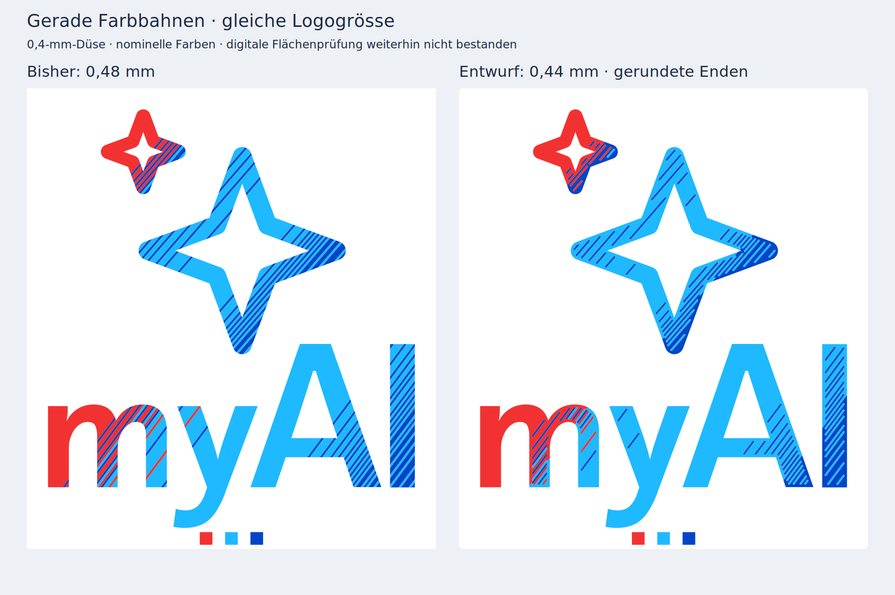

# Testkarte 12 — feinere Streifen mit gerundeten Enden

**Entwicklungsstand, keine Druckempfehlung.** Die 0,44-mm-Variante wurde für die unveränderte **0,4-mm-Düse des P1S** erstellt und mit Bambu Studio 02.08.02.61 geslict. Die Endkorrektur reduziert die Lücken beim besten geprüften Profil, beseitigt sie aber nicht. Auch eine optisch unveränderte Farbverteilung ist nicht erreicht: An den Rändern entstehen erkennbare Zonen der jeweils vorherrschenden Farbe. Die Anforderung «lückenfrei, ohne sichtbare Veränderung» ist damit weiterhin offen.



Die Vorschau zeigt echte CAD-Farbflächen, ohne Beleuchtung, Weichzeichnung oder simulierte Filamentmischung. Sie ist kein Nachweis der Druckbarkeit oder realen Lichtwirkung.

## Was verändert wurde

- **0,44 statt 0,48 mm Bandbreite:** 8,3 % schmaler, entsprechend 9,1 % mehr Bänder pro Strecke. Das ist eine moderate Verfeinerung; die Streifen bleiben sichtbar.
- **Gerundete Enden:** 0,20 mm Rundungsradius, 0,60 mm Abstand der selteneren Farbstreifen zur Logokontur. Die lokale Hauptfarbe füllt diese Randzone. Gerundete Fragmente unter 0,50 mm² werden ebenfalls dieser Hauptfarbe zugeordnet.
- Die Endkorrektur weist **5,46 % der Logofläche** einer anderen Farbe zu. Dieser Wert vergleicht die korrigierten und unkorrigierten **0,44-mm-Bänder**; er umfasst nicht zusätzlich die Änderung gegenüber dem alten 0,48-mm-Raster. Ein unsichtbarer Eingriff lässt sich daraus nicht ableiten.
- Konturen und separate Verlaufsrichtungen von Sternen und Schrift stammen weiterhin aus der unveränderten dunklen Original-SVG. Das bereits bekannte winzige isolierte Originalfragment am A wird entfernt. Keine Wellen und keine weissen Rasterfelder im Logo.
- Die Testkarte erhält 1-mm-Eckradien. Aufbau bleibt **0,4 mm Weiss unten + 0,2 mm Farbe oben**, vollständig plan. Die regulären Lampenseiten wurden nicht geändert.

Die Farbeinteilung verwendet dieselbe Annäherung in linearem RGB und dieselbe fortlaufende Fehlerverteilung wie die akzeptierte Vorschau. Die Endkorrektur ist eine anschliessende geometrische Änderung und wird nicht als exakte Wiedergabe des Originalverlaufs ausgegeben.

## Slicer-Prüfung

Geprüft wurden die vollständigen Farbflächen gegen die tatsächlich erzeugten Druckbahnen, einschliesslich Linienbreiten, runder Bahnenden und Kreisbögen. Zusätzlich werden die richtige Farbe und beide weissen Rückschichten geprüft. Erfolgreiches Slicing allein genügt nicht.

| Variante | Nominell unbedeckt | Nach 0,03 mm Rechentoleranz | Grösste Restlücke |
|---|---:|---:|---:|
| Bisherige Karte 11, 0,48 mm | 0,720 % | 0,338 % | 0,412 mm² |
| Erste Rundung, 0,48 mm, 0,40-mm-Randzone | 1,634 % | 0,854 % | 0,786 mm² |
| 0,44 mm, Arachne, eine Wand | 0,730 % | 0,252 % | 0,361 mm² |
| 0,44 mm, klassisch, drei Wände, 0,40-mm-Linien | 0,738 % | 0,305 % | 0,326 mm² |
| 0,44 mm, Arachne, drei Wände | 0,696 % | 0,227 % | 0,207 mm² |
| 0,44 mm, klassisch, 0,44-mm-Linien | 1,211 % | 0,534 % | 0,417 mm² |
| 0,44 mm, konzentrische Deckfüllung ohne Wände | 0,654 % | 0,231 % | 0,131 mm² |
| **0,44 mm, klassisch, 0,30-mm-Linien — ausgewählt** | **0,549 %** | **0,176 %** | **0,218 mm²** |

Die sechs 0,44-mm-Läufe verwenden dieselbe Geometrie mit 0,60-mm-Randzone. Die erste 0,48-mm-Rundung ist ein anderer Geometrieversuch. Weitere Geometrieversuche mit kleineren Randabständen wurden bereits wegen nicht geschlossener Materialmeshes verworfen und nicht geslict; sie werden nicht ausgeliefert. Die [Versuchsübersicht](../output/line_gradient_refined/profile_trials.json) enthält Profile, Geometriedaten, Prüfergebnisse und Dateihashes der sieben tatsächlich geslicten neuen Läufe. Historische Zwischenstände sind keine zusätzlichen Druckempfehlungen.

Die Auswahl minimiert die gesamte nominelle Lückenfläche. Sie reduziert diese gegenüber Karte 11 um rund **24 %**, besteht aber weiterhin nicht: Nominell fehlen **10,88 mm²**, nach Rechentoleranz noch **3,49 mm²**. Die grösste Lücke beträgt **0,218 mm²**, gegenüber dem unveränderten Grenzwert von 0,01 mm². Die Prüfung auf die richtige Farbe findet 4,20 mm² Fehlfläche, die grösste davon 0,295 mm². Beide weissen Rückschichten bestehen beim ausgewählten Profil.


Die Kriterien bleiben unverändert: höchstens 0,1 % Restfläche und keine einzelne Restfläche über 0,01 mm² nach 0,03 mm geometrischer Toleranz; ebenso für die richtige Farbe und jede Rückschicht. Keine Toleranz wurde zugunsten dieses Entwurfs erhöht. Die nominale Rechnung simuliert keine Schmelze, Haftung oder Hinterleuchtung. **Kein physischer Probedruck und keine bestätigte Behebung der weissen Stellen.**

## Dateien und Einstellungen

[P1S-Datei zur Slicer-Inspektion, mit Restlücken](../output/line_gradient_refined/print/12_refined_line_test_P1S.3mf) · [Status](../output/line_gradient_refined/print/STATUS.md) · [Druckprüfung](../output/line_gradient_refined/print_validation.json) · [Flächenprüfung](../output/line_gradient_refined/surface_coverage.json) · [Geometrieprüfung](../output/line_gradient_refined/geometry_validation.json)

Die Datei bleibt ausdrücklich ein Prüfstand und ist keine empfohlene Wiederholung des Probedrucks. Als Projekt öffnen, um die gespeicherten Druckbahnen zu betrachten.

- P1S, **0,4-mm-Düse**, strukturierte PEI-Platte 55 °C; vier geschlossene Materialmeshes, eine zusammenhängende Karte, keine Stützen.
- AMS **1 Weiss / 2 Blau / 3 Cyanblau / 4 Rot**. Cyan ersetzt in dieser Studie Violett; die Produktionspalette bleibt unverändert.
- Generic PLA 220 °C für alle Farben; Bauteillüfter 50 % nach zwei Schichten, Zusatzlüfter aus. Keine Fremdfarben in die weisse Rückschicht spülen.
- Ausgewähltes Versuchsprofil: klassische Bahnen, drei Wände, 30 % Überlappung zwischen Füllung und Wand; nominell 0,30-mm-Wand-/Decklinien. **Düsendurchmesser, entworfene Bandbreite und Extrusionslinienbreite sind verschiedene Grössen.** Die dünneren Linien sind nur digital untersucht.
- Slicer-Schätzung: **1 h 16 min, 10,66 g** einschliesslich Spülmaterial und Reinigungsturm; drei Farbwechsel.

## Reproduzieren

Eine Python-Umgebung aus `cad/requirements.txt` und Bambu Studio 02.08.02.61 mit offiziellen P1S-Ressourcen verwenden. In dieser Sitzung wurden Python 3.14, Manifold 3.5.4, Shapely 2.2.0, NumPy 2.5.4, Trimesh 5.1.1, CairoSVG 2.9.1 und svgpathtools 1.8.0 verwendet; NumPy/Trimesh weichen dabei von den bestehenden Projekt-Pins ab.

```sh
python cad/build_refined_line_test.py
python scripts/slice_line_gradient_test.py /pfad/zu/bambu-studio --output output/line_gradient_refined
python scripts/validate_line_gradient_test.py --output output/line_gradient_refined
# Erwarteter Fehlerstatus: Flächenprüfung nicht bestanden.
# Audit ohne Druckfreigabe:
python scripts/validate_line_gradient_test.py --output output/line_gradient_refined --allow-withheld
python scripts/render_refined_line_test.py
python scripts/test_raster_coverage.py
python scripts/package.py
```

Parameter stehen im Generator; das ausgewählte Prozessprofil in `cad/refined_line_process.json`. Änderungen erfordern erneutes Bauen, Slicen und Prüfen. Ein Neubau invalidiert vorhandene Druckdateien und Freigabeberichte bereits vor dem Export, auch wenn die neue Geometrieprüfung fehlschlägt. Die Flächenprüfung selbst wurde nicht verändert. Als Regressionstest erzeugt der gemeinsame Kartengenerator die vier STL-Dateien der bisherigen Karte 11 bytegleich; ihre archivierten Ausgaben bleiben erhalten.
