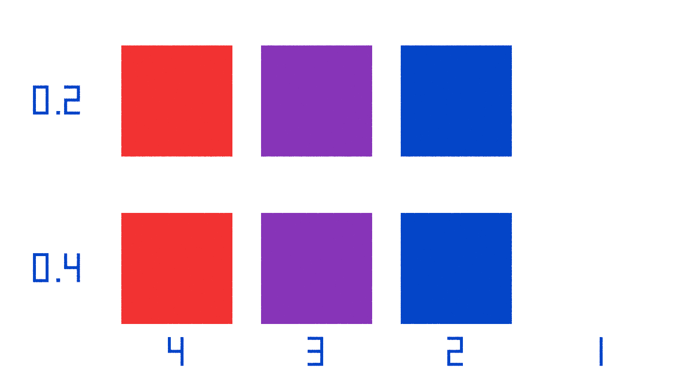

# Abgeschlossener Schichtvergleich: Farbeinlagen hinterleuchten

**Ergebnis:** Der Benutzer wählt für Rot, Violett und Blau **0,2 mm Farbe + 0,4 mm Weiß**. Violett sieht damit deutlich besser aus. Dieser Aufbau ist seit v4.2 in Logo-Probe und Seitenplatte umgesetzt. Ein weiterer Druck dieser Vergleichskarte ist nicht erforderlich.

**Vergleichskarte zum späteren Nachtesten:** [08_transmission_test_P1S.3mf](../output/multicolor_v4_2/print/08_transmission_test_P1S.3mf). Eine zusammenhängende Vergleichskarte, 142 × 80 mm, etwa **1 h 10 min und 16,64 g PLA** einschließlich Spülmaterial und Reinigungsturm. Der separate Reinigungsturm dient dem Farbwechsel und wird nach dem Druck entsorgt.



*Schemafarben zur Orientierung, keine Simulation realer Filamente oder der Hinterleuchtung. Die rein weißen Referenzfelder rechts sind auf der Vorderseite farblich nicht vom Rahmen zu unterscheiden; auf der Rückseite erkennt man ihre dünneren Bereiche.*

## Drucken

- Als Projekt in Bambu Studio öffnen. Vorbereitet für P1S, 0,4-mm-Düse, strukturierte PEI-Platte und 0,20-mm-Schichten; keine Stützen.
- Projekt-Filament **1 = Weiß, 2 = Blau, 3 = Violett, 4 = Rot** den entsprechenden AMS-Fächern zuordnen. Dieselben vorhandenen Spulen wie bei der bisherigen Farbprobe verwenden, insbesondere **3DJake ecoPLA Purple**.
- Violett ist für diese Karte auf **210 °C** eingestellt, innerhalb des [Herstellerbereichs von 195–215 °C](https://www.3djake.ch/de-CH/3djake/ecopla-violett). Die übrigen Farben verwenden das vorhandene Generic-PLA-Profil mit 220 °C; Bett 55 °C. Bei abweichenden bewährten Filamentprofilen diese auswählen und neu slicen. Beide Reihen werden jeweils mit demselben Profil gedruckt.
- Die farbige Vorderseite liegt beim Druck auf dem Bett. Ausrichtung und Maßstab beibehalten. Nach dem Abkühlen vorsichtig ablösen und Brim entfernen.

## So hältst du die Karte

**Farbige Seite mit lesbaren Zahlen zu dir, abgeschrägte Ecke oben links.** Die LED kommt hinter die weiße Rückseite. Von links nach rechts: **Rot, Violett, Blau, Weiß**. Die Zahlen unten sind die Projekt-Filamentnummern.

| Aufgedruckte Zeile | Farbige Vorderseite | Weiße Rückschicht | Gesamtdicke im Prüffeld |
|---|---:|---:|---:|
| **0.2** oben | 0,2 mm | 0,4 mm | 0,6 mm |
| **0.4** unten | 0,4 mm | 0,2 mm | 0,6 mm |

Die beiden weißen Referenzfelder rechts sind durchgehend 0,6 mm weiß. Rahmen und Stege sind 1,0 mm dick; ihre Helligkeit ist kein Vergleichsmaßstab. Jedes Prüffeld misst 24 × 24 mm.

## Was wir wissen wollen

1. **Ohne LED:** Beide violetten Felder nebeneinander beurteilen. Ändert die dünnere Farbschicht den Farbton oder scheint das Weiß störend durch?
2. **Mit LED:** Jedes Feld nacheinander mittig vor dieselbe LED halten, bei gleichem Abstand, gleicher Helligkeit und gleichem Umgebungslicht. Die farbige Seite bleibt zu dir gerichtet. Bleibt Violett oben erkennbar, oder wird es ebenfalls fast schwarz?
3. **Farben vergleichen:** Wie hell sind Rot, Violett und Blau innerhalb derselben Reihe? Welcher Aufbau bietet den ausgeglicheneren Eindruck?
4. **Weiße Referenzen:** Unter identischen Bedingungen sollten beide ähnlich hell erscheinen. Große Unterschiede sprechen zunächst für ungleiche Beleuchtung oder Druckabweichungen.

Am hilfreichsten ist eine Rückmeldung in dieser Form:

> 0.2: Violett …; Rot …; Blau …\
> 0.4: Violett …; Rot …; Blau …\
> Ohne LED gefällt mir …; mit LED gefällt mir …

Der Test vergleicht zwei komplette Schichtaufbauten bei gleicher Gesamtdicke. Er misst die Lichtdurchlässigkeit des violetten Filaments nicht isoliert, da sich auch die weiße Rückschicht ändert. Ein besseres Ergebnis muss anschließend am vollständigen Logo bestätigt werden. Das Raster ist weiterhin ein separater Gestaltungsvorschlag.

## Digitaler Prüfstand

Die CAD-Prüfung bestätigt geschlossene Materialvolumen, eine zusammenhängende Karte, überschneidungsfreie Farben und den Materialaufbau in allen acht Feldern. Die G-Code-Prüfung kontrolliert je Feld die tatsächlich extrudierten Filamente auf 0,2 / 0,4 / 0,6 mm Höhe, zusätzlich AMS-Zuordnung, Bettgrenzen, Stützfreiheit und Prüfsummen. Die Karte wurde vom Benutzer beurteilt: 0,2 mm Farbe wird für alle drei Farben gewählt, mit deutlich besserer Wirkung von Violett. Die digitale Prüfung ist von dieser subjektiven Praxisbewertung zu unterscheiden.

Quellen: [Generator](../cad/build_transmission_test.py), [Geometrieprüfung](../output/multicolor_v4_2/transmission_test/geometry_validation.json), [Druckprüfung](../output/multicolor_v4_2/print_validation.json).

```sh
.venv/bin/python cad/build_transmission_test.py
.venv/bin/python scripts/slice_multicolor.py /pfad/zu/bambu-studio --plates 08_transmission_test
.venv/bin/python scripts/validate_multicolor.py
blender -b -t 4 --python scripts/render_transmission_test.py
.venv/bin/python scripts/package.py
```
