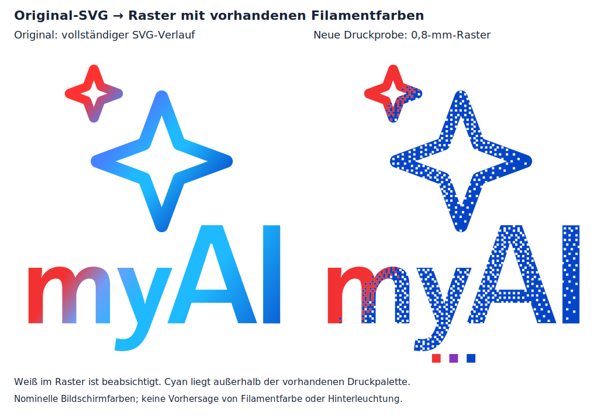

# Rasterprobe 10 aus dem Originalverlauf

**Aktuelle Datei:** [10_raster_original_test_P1S.3mf](../output/multicolor_v4_2/print/10_raster_original_test_P1S.3mf). Die frühere Probe 09 ist verworfen und bleibt als [dokumentierter Vergleich](RASTERPROBE_09.md) erhalten.



*Nominelle Bildschirmfarben, keine Vorhersage realer Filamentfarben oder Hinterleuchtung. Weiße Punkte im neuen Logo sind gewollte Rasterelemente.*

## Was korrigiert wurde

Die bisherige Probe las die Originalkonturen und Verlaufsrichtungen, ersetzte aber die tatsächlichen Farbstopps durch einen künstlichen Rot–Violett–Blau-Verlauf. Das entsprach nicht dem gewünschten Raster des Originals. Die neue Probe liest **alle Farbstopps, Farben und Positionen direkt aus der unveränderten dunklen Original-SVG**, auch für den Schriftzug. Die helle SVG besitzt einen einfarbigen Schriftzug und ist deshalb hier nicht die Quelle.

Der originale Verlauf enthält deutlich mehr Hellblau und Cyan als der frühere Entwurf. Mit Weiß, dem vorhandenen dunklen Blau, Violett und Rot ist dieser Farbraum nicht vollständig erreichbar. Das neue Raster verwendet Weiß zum Aufhellen. **Cyan bleibt eine sichtbare Grenze dieser Filamentpalette; ein feineres Raster allein behebt das nicht.** Für eine nähere Cyan-Wiedergabe müsste die Palette geändert und mit realen Filamentproben kalibriert werden.

Aus den Originalfarben werden angenäherte Flächenanteile der vorhandenen Palette berechnet. Eine zeilenweise wechselnde Fehlerverteilung ersetzt das regelmäßige Bayer-Schachbrett. Bei der aktuellen nominellen Palette und 0,8-mm-Auflösung werden im Logo Weiß, Blau und Rot gewählt; **Violett wird nicht künstlich in den Verlauf erzwungen**. Drei kleine Referenzfelder unter dem Logo zeigen Rot, Violett und Blau unabhängig von der Rasterberechnung. Damit bleibt auch das tatsächlich geladene Violett vergleichbar.

Die Vorschau sollte vor einem weiteren Druck beurteilt werden: Die Berechnungsgrundlage ist korrigiert, die Farbtreue zum Original ist mit den vorhandenen Spulen weiterhin begrenzt.

## Druck und Ablösen

- **P1S, 0,4-mm-Düse, PLA, strukturierte PEI-Platte und AMS.** Datei in Bambu Studio **als Projekt** öffnen. Bei einer anderen Druckplatte das passende Profil wählen und neu slicen.
- Projekt-Filamente: **1 Weiß · 2 Blau · 3 Violett · 4 Rot**. Wie bisher 210 °C für ecoPLA Purple, 220 °C für die übrigen Generic-PLA-Profile und 55 °C Bett. Keine pauschale Temperaturerhöhung.
- **Neu: weiße Rückseite unten, farbige Sichtseite oben.** Orientierung beibehalten, nicht spiegeln. Zuerst 0,4 mm durchgehendes Weiß, anschließend 0,2 mm Farbe beziehungsweise weiße Rasterpunkte. Gesamtdicke weiterhin 0,6 mm. Die Sichtseite zeigt Druckbahnen statt PEI-Struktur, bleibt geometrisch bündig.
- Karte **96,9 × 109,1 mm**, Logo **86,9 × 99,1 mm** in späterer Originalgröße, Raster **0,8 mm**.
- Etwa **1 h 9 min und 10,62 g PLA** laut Slicer, einschließlich Reinigungsturm und Spülmaterial. Drei Farbwechsel, keine Stützen. Turm und Haftrand sind keine weiteren Prüfteile.
- **Bis auf Raumtemperatur abkühlen lassen.** Die Federstahlplatte vorsichtig biegen und die Karte flächig unterstützen, statt die dünne Karte warm abzuziehen. Nicht stark durchknicken. Bambu empfiehlt bei strukturierter PEI mindestens auf 35 °C oder darunter abzukühlen; für diese empfindliche Karte warten wir bis Raumtemperatur. [Herstellerhinweis](https://us.store.bambulab.com/collections/accessories-for-a1-mini/products/bambu-textured-pei-plate).

Das eigene Profil druckt Außenwände, Oberseite und Lückenfüllung mit 25 mm/s, Innenwände mit 30 mm/s und die weiße Vollfüllung mit 40 mm/s. Es verwendet klassische Wandbahnen mit Dünnwand-Erkennung, 0,4-mm-Linien auf der Farbseite und keine absichtliche Nahtlücke. Im digitalen Vergleich blieben damit die geprüften Zellmitten besser erhalten als mit den untersuchten Arachne-Einstellungen. Zusatzlüfter aus, Bauteillüfter in den ersten beiden Schichten aus und anschließend auf 50 %. Diese Maßnahmen sind ein **noch nicht physisch bestätigter Versuch**, die Flächen zu schließen und die Verbindung der Schichten zu verbessern. Andere Druckprojekte behalten ihre Profile.

## Warum können weiße Stellen sichtbar werden?

Rückmeldung vom 18. Oktober 2026: Die alte Rasterprobe gefällt farblich nicht. Beim Ablösen wirken manche Farbstellen weggerissen; Weiß schimmert durch. Auf der Platte sind **keine sichtbaren Rückstände**, sie war **noch lauwarm**. Der konkrete Plattentyp wurde nicht bestätigt.

Damit ist ein Abreißen der Farbe vom weißen Untergrund noch nicht nachgewiesen. Drei Erklärungen bleiben offen:

1. **Drucklücken:** Die Farbe ist nur eine Schicht dick. Jede kleine Lücke zeigt die weiße Rückschicht. Die alte Druckbahnprüfung belegte den Erhalt der Rasterzellen, ausdrücklich keine vollständig geschlossene Oberfläche. Digitale Restlücken sind deshalb eine plausible Ursache.
2. **Mechanische Aufhellung:** Starkes Biegen kann Kunststoff lokal aufhellen, ohne dass ein Stück auf der Platte zurückbleibt. Eine solche Spannungsaufhellung wurde auch an gedrucktem PLA unter Biegebelastung beobachtet; das ist ein möglicher Mechanismus, keine Diagnose dieser Karte. [PLA-Biegeuntersuchung](https://www.mdpi.com/2673-4591/119/1/18).
3. **Schwache Schichtverbindung:** Falls tatsächlich Material fehlt, können unzureichende Verschmelzung, zu starke Kühlung oder unvollständige Extrusion beteiligt sein. Die alte Probe hatte viele kleine, direkt auf dem Bett liegende Farbinseln. Eine zu schwache Verbindung zur Rückschicht kann beim Ablösen nachgeben. Temperatur und Kühlung beeinflussen die Schichthaftung. [Prusa: Schichttrennung](https://help.prusa3d.com/article/layer-separation-and-splitting-fdm_1806).

Die neue Druckrichtung entfernt den direkten Kontakt der Farbinseln zur Platte. Sie verhindert weder garantiert Spannungsaufhellung noch schlechte Schichthaftung. Vor dem Ablösen die jetzt oben sichtbare Farbseite fotografieren und nach vollständigem Abkühlen vergleichen: Bereits vorhandene Lücken sprechen für Druckbahnen/Extrusion; erst beim Biegen auftretende Aufhellung ohne fehlendes Material eher für mechanische Belastung. Vertiefungen oder lose farbige Stücke würden echten Materialverlust stützen. Die geplanten weißen Rasterpunkte mit der Vorschau vergleichen.

## Was die neue Probe beantwortet

Den Verlauf ohne Beleuchtung und mit LED hinter der weißen Rückseite beurteilen. Für den Vergleich denselben LED-Abstand verwenden. Aus etwa 50–100 cm Entfernung prüfen, ob die Körnung akzeptabel ist. Zusätzlich vor/nach dem Ablösen auf neue weiße Stellen achten. Die Änderung von Raster, Orientierung und Profil ist kein isolierter Materialversuch; damit lässt sich eine einzelne Ursache nicht abschließend bestimmen.

Die regulären Seitenplatten bleiben beim bisherigen Entwurf. Diese flache Probe prüft weder Führungen noch Montage oder Wärmeverhalten. Ein direkter Übertrag der neuen Druckrichtung auf Platten mit inneren Führungsleisten ist noch nicht konstruiert.

## Digitaler Prüfstand und Reproduktion

- Original-SVG unverändert; alle Farbstopps geprüft. **2.899 innere Bildpunkte** gegen den unabhängigen CairoSVG-Renderer verglichen: höchstens **0,53 von 255 Kanalwerten** Abweichung. Das prüft das Einlesen der Quelle, nicht die Qualität der Filamentapproximation.
- Originalkontur und Originalgröße erhalten. 60 winzige Randinseln mit zusammen 6,75 mm² benachbarten Farben zugeordnet; 0,08-mm-Rundungen lösen diagonale Punktkontakte geometrisch auf. Keine zugesicherte Druckauflösung dieser Rundungen.
- Geschlossene Materialnetze, zusammenhängende Karte, Materialabdeckung und Überschneidungen geometrisch geprüft. Weiße Basis über die gesamte Karte, Farbvolumen ausschließlich bei Z = 0,4–0,6 mm.
- Geslicte P1S-Datei: korrekte AMS-Zuordnung, gültige G-Code-Prüfsumme, Bettgrenzen, keine Stützen oder Slicer-Druckwarnungen. Schichten bei 0,2 und 0,4 mm nur Weiß; bei 0,6 mm alle vier Farben einschließlich Referenzfelder.
- In allen **2.366 vollständigen Rasterzellen** und den drei Referenzfeldern erreicht die vorgesehene Farbe den zentralen Bereich mit 0,2 mm Durchmesser; die weißen Basisschichten decken die Zellmitten. Größter berechneter Abstand einer Zellmitte zum Farbauftrag: **0,083 mm**. **Keine Zusicherung einer lückenlosen Oberfläche**, exakter Randpixel oder realer Schichthaftung.

[Geometrie](../output/multicolor_v4_2/raster_original_test/geometry_validation.json) · [Originalfarben](../output/multicolor_v4_2/raster_original_test/color_validation.json) · [Druckbahnen](../output/multicolor_v4_2/raster_original_test/toolpath_validation.json) · [Farbige Deckschicht als Druckbahnansicht](../output/multicolor_v4_2/preview/raster_original_toolpaths.png).

```sh
.venv/bin/python cad/build_raster_original_test.py
.venv/bin/python scripts/validate_original_colors.py
.venv/bin/python scripts/slice_multicolor.py /pfad/zu/bambu-studio --plates 10_raster_original_test
.venv/bin/python scripts/validate_multicolor.py
blender -b -t 4 --python scripts/render_raster_original_test.py
.venv/bin/python scripts/package.py
```

Bambu Studio 2.8.2.61. Die Druckdatei enthält Geometrie und G-Code, jedoch kein eingebettetes Vorschaubild. Die ältere Probe 09 und ihre Druckdateien bleiben unverändert archiviert.
